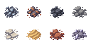

# Beltbound

Beltbound is an original top-down factory game about gathering resources and building a factory. It's a learning project built with C++17 and SFML 3.1.

## Current prototype

- **W/A/S/D** pans a camera bounded to the map.
- The prototype starts with one grass tile near the center of the grid. A transparent Kenney outline marks the hovered cell.
- **F3** toggles the 100 × 100 grid and debug overlay together.
- **Left-click** paints grass in the cell under the mouse. Painted cells remain for the current run.

Next, keep one grass entry per cell when it is clicked repeatedly.

*Original Tier 1 sprite atlas with eight 32 × 32 resource sprites prepared for future gameplay.*

## Windows setup

1. Install **WinLibs GCC 14.2.0 (64-bit UCRT, SEH)** so the compiler and GNU Make are available at `C:\mingw64\bin\g++.exe` and `C:\mingw64\bin\mingw32-make.exe`. The VS Code debugger uses `C:\mingw64\bin\gdb.exe` from the same package. [Matching toolchain and SFML downloads](https://www.sfml-dev.org/download/sfml/3.1.0/)
2. From that download page, choose the **SFML 3.1.0 Windows package for GCC 14.2.0 MinGW (UCRT), 64-bit**. Extract it so the `include`, `lib`, and `bin` folders sit directly inside `vendor/SFML-3.1.0`.
3. Obtain a licensed copy of Backterria's Adventure terrain sheet (`The Ground v1-1.png`). Copy it to `assets/tilesets/The Ground v1-1 - Bright.png` before building. The original and bright variant share the same tile layout. Beltbound exits if it cannot load the sheet at startup. Keep the paid sheets and modified copies local. [The Ground on itch.io](https://backterria.itch.io/the-ground)

## Build and run

- Open the repository in VS Code. Press **Ctrl+Shift+B** for an incremental build, then run `.\build\FactoryGame.exe` in the terminal.
- Press **F5** with **Debug Beltbound** selected to build incrementally and launch the debugger.
- For a full rebuild, choose **Tasks: Run Task** from the Command Palette, then **Rebuild Beltbound (Full)**.

From PowerShell in the repository root, run `.\build.ps1` for an incremental build or `.\build.ps1 -Rebuild` for a full rebuild. The build copies the runtime DLLs and assets beside the executable.

## Project notes

- [Development log](docs/CHANGELOG.md)
- [Architecture notes](docs/architecture.md)
- [Asset credits and licenses](docs/credits.md)
